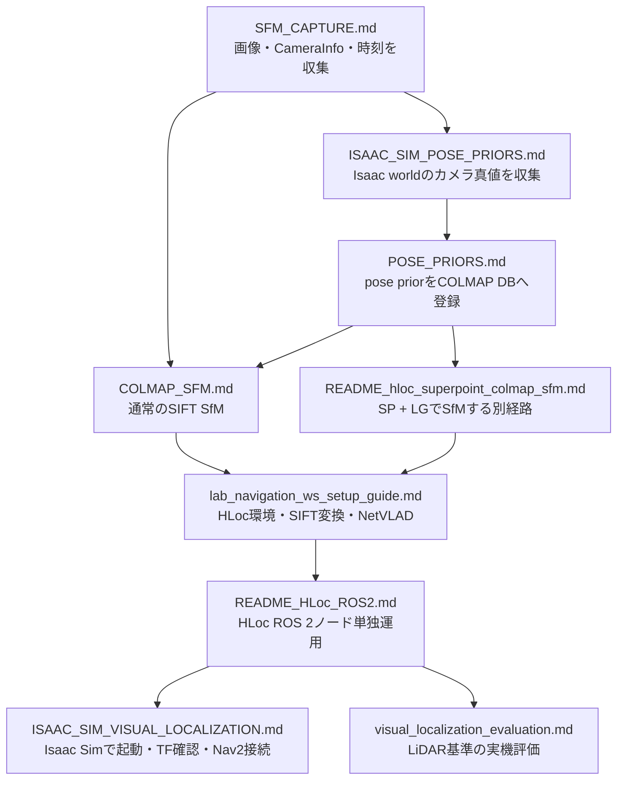

# lab_navigation_ws ドキュメント案内

このファイルをワークスペースのドキュメント入口とします。
Isaac Simでpose prior付きSfMを作成し、HLocによるVisual LocalizationをNav2へ接続する場合は、
最初に [ISAAC_SIM_VISUAL_LOCALIZATION.md](ISAAC_SIM_VISUAL_LOCALIZATION.md) を参照してください。

## 文書の関係

## 目的別の参照先

| 目的 | 正本 | 補足 |
| --- | --- | --- |
| SfM用画像を収集する | [SFM_CAPTURE.md](SFM_CAPTURE.md) | 実機・シミュレーション共通 |
| Isaac Simのカメラ真値をpose priorとして使う | [ISAAC_SIM_POSE_PRIORS.md](ISAAC_SIM_POSE_PRIORS.md) | `/sfm_gt_tf`の作成と抽出 |
| 保存済みTFから一般的なpose priorを作る | [POSE_PRIORS.md](POSE_PRIORS.md) | 実機や既存bagにも使用 |
| SIFTで通常のSfMを行う | [COLMAP_SFM.md](COLMAP_SFM.md) | pose priorなしの経路も含む |
| HLoc・仮想環境を構築する | [lab_navigation_ws_setup_guide.md](../src/hloc_localizer/lab_navigation_ws_setup_guide.md) | `.venv`、依存関係、NetVLAD |
| HLoc用SIFTデータを作る | [lab_navigation_ws_setup_guide.md](../src/hloc_localizer/lab_navigation_ws_setup_guide.md) | COLMAP特徴量変換とNetVLAD生成 |
| 既存SIFT地図にSP + LG地図を追加する | [README_HLoc_ROS2_SP_LG.md](../src/hloc_localizer/README_HLoc_ROS2_SP_LG.md) | 元のSIFT地図を維持して再三角測量 |
| SP + LGでpose prior付きSfMを行う | [README_hloc_superpoint_colmap_sfm.md](../src/hloc_localizer/README_hloc_superpoint_colmap_sfm.md) | spatial pairと画像間引きを含む |
| HLoc ROS 2ノードを単独確認する | [README_HLoc_ROS2.md](../src/hloc_localizer/README_HLoc_ROS2.md) | topic、TF、SIFT/SP切替 |
| Isaac SimでHLoc + Nav2を動かす | [ISAAC_SIM_VISUAL_LOCALIZATION.md](ISAAC_SIM_VISUAL_LOCALIZATION.md) | 現在の統合手順 |
| launchファイルの役割を確認する | [launch/README.md](../src/lab_navigation/launch/README.md) | 環境・測位方式ごとの一覧 |
| Visual Localizationの一般設計を確認する | [NAV2_VISUAL_LOCALIZATION.md](NAV2_VISUAL_LOCALIZATION.md) | 座標、TF、Nav2接続の背景 |
| 実機でLiDAR基準の評価を行う | [visual_localization_evaluation.md](../src/lab_navigation/docs/visual_localization_evaluation.md) | Isaac Sim真値評価とは別経路 |

## Visual Localizationの成果物

処理段階ごとに成果物の責任を分けます。

| 段階 | 主な成果物 |
| --- | --- |
| 収集 | `images/`, `timestamps.csv`, `camera_info.json`, `bag/` |
| pose prior抽出 | `poses.csv`, `poses_report.json` |
| SfM | `database.db`, `sparse/0/{cameras,images,points3D}.bin` |
| HLoc参照データ | `hloc_output/feats-shift.h5`, `hloc_output/global-ref-netvlad.h5` |
| SP + LGを使う場合 | `hloc_output_superpoint_lightglue/`以下の特徴量・match・再三角測量モデル |
| ROS 2実行 | `/hloc/camera_pose`, `/hloc/localization_status`, `map -> odom` |
| 評価 | Ground Truthと同一時刻・同一座標系で比較した誤差と成功率 |

`captures/`以下のREADMEや結果ファイルは、その収録データ固有の記録です。
ワークスペース全体の手順書としては扱いません。`src/external/`と`third_party/`の文書は、
各外部プロジェクトの文書です。

## 整理方針

- 同じコマンドを複数文書へ複製せず、詳細な正本へリンクします。
- 実験固有の数値は該当する実験文書に置き、一般手順と分けます。
- raw会話ログを手順書として残さず、確認済みの内容だけを正本へ反映します。
- TFの配信者は役割ごとに1つとし、特に`map -> odom`の二重配信を避けます。
